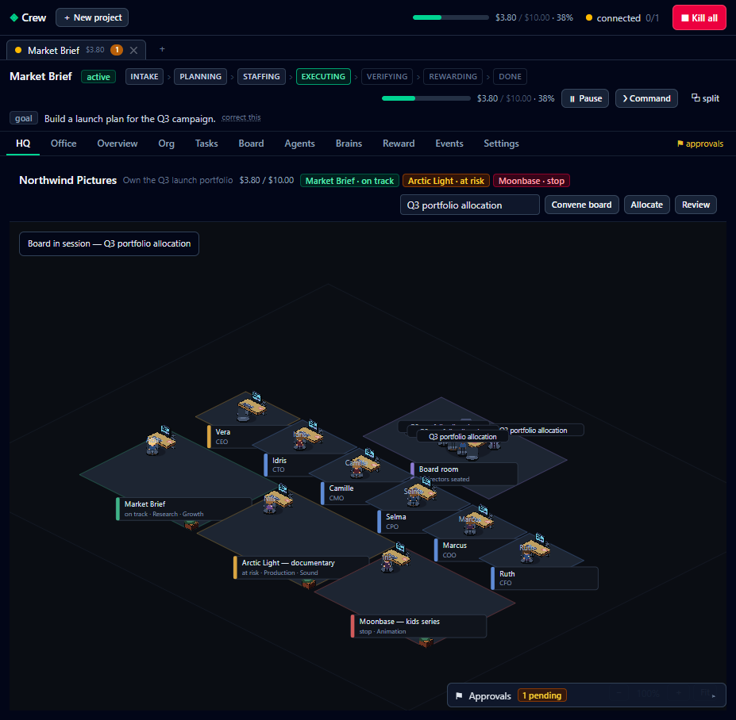

# Crew — Autonomous Agent Organization Platform

Crew is a platform for running **self-organizing crews of AI agents** across multiple
independent projects. Each project is a tab in the UI, owns its own org chart, budget,
memory ("brain") and task queue, and grows its own departments and agent swarms on demand
to achieve the goals you give it.

Execution of individual AI work is delegated to [CrewAI](https://crewai.com) (agents, tasks,
crews, flows). Crew adds the layers above it: the **organization**, the **command chain**,
the **reward system**, the **memory hierarchy**, **security governance** and **observability**.

Everything is watched and steered from one tabbed control room: a **2.5D office floor** where
the org literally grows on screen, a **kanban board** (epics → features → stories → bugs)
whose ready items become real tasks, a **company layer** with a CEO, a board of directors and
a portfolio of projects, and the **Command desk** — you write to the company in plain words
as **the Captain** (orders bind, ideas are weighed, questions are answered), the orchestrator
turns them into real actions, and every one of them lands on the record, attributed.


<p>
  
  
</p>

## Repository layout

```
backend/          Python 3.12 · FastAPI · SQLAlchemy · CrewAI execution engine
frontend/         React 19 · TypeScript · Vite · tabbed control room
docs/             Refinement documentation (read this first)
docs/adr/         Architecture Decision Records
dev/mock/         Zero-dependency API mock — the UI and the office, with no backend and no keys
```

## Read the docs in order

| # | Document | What it settles |
|---|----------|-----------------|
| — | [docs/README.md](docs/README.md) | Index and reading order |
| 00 | [Vision & Scope](docs/00-vision-and-scope.md) | What we build, what we explicitly do not |
| 01 | [System Architecture](docs/01-system-architecture.md) | Components, layers, tech stack, runtime |
| 02 | [Organization & Command Chain](docs/02-organization-and-command-chain.md) | Project/Department/Squad/Agent, authority, spawning |
| 03 | [Orchestration & Lifecycle](docs/03-orchestration-and-lifecycle.md) | From goal to execution to termination |
| 04 | [Agent Model & Skills](docs/04-agent-model-and-skills.md) | Roles, skills, tools, model routing |
| 05 | [Reward & Performance](docs/05-reward-and-performance.md) | Scoring, promotion, anti-gaming |
| 06 | [Memory & Brains](docs/06-memory-and-brains.md) | Three-level brain, promotion of insight |
| 07 | [Observability](docs/07-observability.md) | Events, traces, live views, replay |
| 08 | [Security & Governance](docs/08-security-and-governance.md) | Auth, secrets, sandbox, egress, budgets |
| 09 | [UI/UX Spec](docs/09-ui-ux-spec.md) | Tabs, views, control surfaces |
| 10 | [Data Model](docs/10-data-model.md) | Tables and invariants |
| 11 | [API & Event Contract](docs/11-api-and-event-contract.md) | REST + WebSocket message shapes |
| 12 | [Implementation Plan](docs/12-implementation-plan.md) | Milestones M0–M10 and exit criteria |
| 13 | [Backend implementation notes](docs/13-backend-implementation-notes.md) | What is built, what is deliberately stubbed, and the bugs already found |

Short on time? Read **00 → 02 → 09** first; everything else is reference. The audits and
renderer notes (14–17) are indexed in [docs/README.md](docs/README.md).

## Quick start

### Fastest — Docker, two commands, no local toolchain

```bash
docker compose up    # backend on http://127.0.0.1:8787, control room on http://localhost:5173
```

It boots **keyless in offline mode** (`CREW_OFFLINE_LLM=true` in `docker-compose.yml`): the
full pipeline runs against a deterministic fake model — zero spend, nothing to configure.
Create a project, give it a goal, watch the org form. Put real keys in a `.env` at the repo
root to switch to live providers (see **Model providers** below).

### Local development (uv + npm)

```bash
# 1. backend  (API + orchestrator; serves the REST contract and the event socket)
cd backend
uv sync
cp ../.env.example .env          # provider keys — see “Model providers” below
uv run python -m crew serve      # http://127.0.0.1:8787  (docs at /docs)

# 2. frontend (tabbed control room)
cd ../frontend
npm install
npm run dev                      # http://localhost:5173

# 3. optional: same pipeline with zero spend and zero keys (deterministic fake runner)
CREW_OFFLINE_LLM=true uv run python -m crew serve
```

### Model providers — one key is enough, if it is the right one

The model tiers default to **DeepSeek** (`deepseek/deepseek-chat` for standard/fast,
`deepseek/deepseek-reasoner` for reasoning), so **`DEEPSEEK_API_KEY` is the single key that
works out of the box**. Using OpenAI, Anthropic or a local model instead? Point the tiers at
it in `.env`:

```bash
CREW_TIER_STANDARD=openai/gpt-4o-mini
CREW_TIER_FAST=openai/gpt-4o-mini
CREW_TIER_REASONING=anthropic/claude-sonnet-4-5
```

Embeddings default to `openai/text-embedding-3-small`; without that key the brain's semantic
recall is skipped — everything else keeps working. `uv run python -m crew status` prints
which tiers have a key present.

### Fastest possible look: the mock, no backend and no keys

If you only want to see the control room and the office — no Python, no provider keys, no
spend — run the API mock instead of the backend:

```bash
node dev/mock/server.mjs                                  # http://127.0.0.1:8788
cd frontend && echo 'VITE_API_BASE=http://127.0.0.1:8788' > .env.local && npm run dev
```

Open the project and the office floor: the organization grows on its own while you watch
(a hire at t+12, a whole new department at t+30). See [dev/mock/README.md](dev/mock/README.md)
for what it does and does not promise.

Useful commands:

```bash
uv run pytest                    # 103 tests, no network required
uv run pytest -m live -s         # real provider run (needs a key; costs a few cents)
uv run ruff check src tests
uv run python -m crew status     # env, data dir, model tiers, sandbox mode
uv run python -m crew audit verify
uv run python -m crew run --project <id> --goal "…"   # run a goal headlessly
```

Configure a project you want to try end to end:

1. Create a project (UI tab, or `POST /api/projects`).
2. State a goal: `POST /api/projects/{id}/runs {"goal": "...", "mode": "autonomous"}`.
3. Watch the tabs: **Org** (it hires itself), **Tasks**, **Agents** (live timelines),
   **Reward** (score changes), **Events** (the raw stream).

Read [docs/13](docs/13-backend-implementation-notes.md) before changing code: it lists what is
implemented, what is deliberately stubbed, and the bugs already found and fixed.

## Status

See [docs/12-implementation-plan.md](docs/12-implementation-plan.md) for the current
milestone. Milestone state is tracked there, not in this README.

## License

MIT — see [LICENSE](LICENSE).
