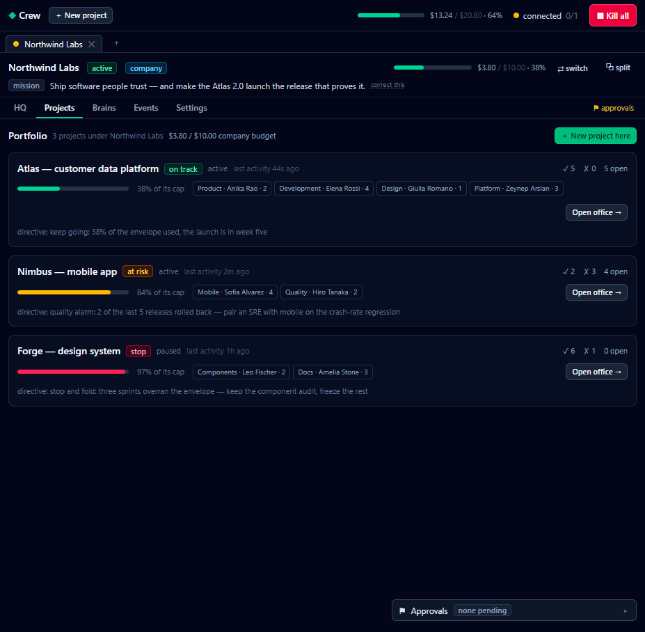

# Crew

**An autonomous agent organization platform — real org charts, a real command chain, budgets with teeth, and a 2.5D office where you can watch it all happen.**

[](https://github.com/dogukandemir/crew/actions/workflows/ci.yml)
[](LICENSE)
[](backend/pyproject.toml)
[](frontend/package.json)

Crew runs **self-organizing crews of AI agents** across independent projects. Each project is
a tab in the UI, owns its own org chart, budget, memory ("brain") and task queue, and grows
its own departments and agent swarms on demand to reach the goals you give it.

Execution of individual AI work is delegated to [CrewAI](https://crewai.com) (agents, tasks,
crews, flows). Crew adds the layers above it: the **organization**, the **command chain**,
the **reward system**, the **memory hierarchy**, **security governance** and **observability**.

Security posture (ADR 0017): every company picks a **workspace root** at founding (default
`~/crew/workspace/{company}/{project}`) and agents are jailed to that tree — file tools
contained, shell/Python container-only with no network, egress allowlisted. Fetched content and
executed commands pass a **security review** before use: risky findings go to a human approval
(the risky content or command shown as-is), and an approved command can be kept on an
**always-allow list** — audited and revocable.


<p>
  
  
</p>

## Why it's different

- **The org chart is a runtime artifact.** Departments, squads and agents are generated from
  the goal's capability requirements — and dissolve or rebuild as the needs change. Nobody
  hard-codes a team.
- **A real command chain.** Orchestrator → function chiefs (C-level) → department heads →
  squad leads → workers. Escalation and delegation both follow the chain, and a **board of
  directors** governs the whole portfolio one level above it.
- **Rewards with teeth.** Agents are scored on verified outcomes, cost efficiency and
  quality; reputation gates model tier, spend limits, autonomy and promotion. Only verifier
  verdicts move a score — producer output never does.
- **Three-level cognition.** Project, department and agent brains with controlled promotion
  of insights, so the org gets smarter without every agent drowning in every other agent's
  context.
- **The Captain's command desk.** You write to the company in plain words — *an order, an
  idea, or a question*. The orchestrator parses it, executes it against the real services
  (assign, reassign, fire, breaks, goals, budgets, hires), and every action lands on the
  record, attributed end to end. No god-hands, no whispers.
- **People, not templates.** Every hire gets a **soul** — a human name, personality, values,
  a vision and a voice that ride the system prompt — and growth hires are interviewed by a
  **Head of People**: candidates are scored against the real gap, the real budget and the
  floor they would join; misfits are rejected with cited reasons, at most two before one
  always lands (ADR 0016). Realism, bounded.
- **Observability as a first-class feature.** Every thought, tool call, token and dollar is
  an append-only event. Watch live by project, department or agent; replay history like a
  video; verify the hash-chained audit trail.

## Quick start

### Fastest — Docker, two commands, no local toolchain

```bash
docker compose up    # backend on http://127.0.0.1:8787, control room on http://localhost:5173
```

It boots **keyless in offline mode** (`CREW_OFFLINE_LLM=true` in `docker-compose.yml`): the
full pipeline runs against a deterministic fake model — zero spend, nothing to configure.
Create a project, give it a goal, watch the org form. Put real keys in a `.env` at the repo
root to switch to live providers (see **Model providers** below).

### Local development (uv + npm)

Requires [uv](https://docs.astral.sh/uv/) and Node 22+.

```bash
# 1. backend  (API + orchestrator; serves the REST contract and the event socket)
cd backend
uv sync
cp ../.env.example .env          # provider keys — see “Model providers” below
uv run python -m crew serve      # http://127.0.0.1:8787  (docs at /docs)

# 2. frontend (tabbed control room)
cd ../frontend
npm install
npm run dev                      # http://localhost:5173
```

On first launch the control room offers a **provider picker** — DeepSeek, OpenAI,
Anthropic, OpenRouter, or **local Ollama** (no key, zero spend). The key is verified
against the provider, stored encrypted in the local vault, and the choice points every
model tier at that provider immediately. No `.env` edit, no restart.


Next comes the **founding wizard**: pick a template (or open *Detailed setup*), name the
company, and one call (`POST /api/found`) creates the company with its CEO and board, its
first project **under it**, and starts the first run. The company floor (HQ) then holds
the portfolio — each member one breadcrumb below, with its own office. Standalone projects
still work: the new-project dialog's *Company* selector defaults to the first company but
offers `— standalone —`.



### Model providers — one key is enough, if it is the right one

The model tiers default to **DeepSeek V4**: `deepseek/deepseek-flash` for the standard and
fast tiers, `deepseek/deepseek-v4-pro` for reasoning. (The legacy names `deepseek-chat` and
`deepseek-reasoner` were retired by the provider on 2026-07-24 — don't pin them.) Thinking
is on by default per request; its level is one setting:

```bash
CREW_REASONING_EFFORT=high      # low | high | max (provider default: high)
```

So **`DEEPSEEK_API_KEY` is the single key that works out of the box** — via the onboarding
card or in `.env`. Using OpenAI, Anthropic or a local model instead? Point the tiers at it:

```bash
CREW_TIER_STANDARD=openai/gpt-4o-mini
CREW_TIER_FAST=openai/gpt-4o-mini
CREW_TIER_REASONING=anthropic/claude-sonnet-4-5
```

OpenRouter carries hundreds of models behind one key — including hosted Ollama cloud
models (`openrouter/anthropic/claude-sonnet`, `openrouter/openai/gpt-4o-mini`). Local
**Ollama** needs no key at all: point `OLLAMA_BASE_URL` at your server and set the tiers
to `ollama/llama3.2` — local inference bills **$0** to the budget guard.

Embeddings default to `openai/text-embedding-3-small`; without that key the brain's semantic
recall is skipped — everything else keeps working. `uv run python -m crew status` prints
which tiers have a key present.

### No keys at all? Two ways

```bash
# a) the offline runner — the same pipeline against a deterministic fake model, zero spend
CREW_OFFLINE_LLM=true uv run python -m crew serve

# b) the mock — just the control room and the office, no Python, no provider keys
node dev/mock/server.mjs                                  # http://127.0.0.1:8788
cd frontend && echo 'VITE_API_BASE=http://127.0.0.1:8788' > .env.local && npm run dev
```

With the mock the organization grows on its own while you watch (a hire at t+12, a whole new
department at t+30). See [dev/mock/README.md](dev/mock/README.md) for what it does and does
not promise.

## The control room

Every project opens as a tab; each tab keeps its own route, filters and scroll position.

- **Office** — the 2.5D floor: rooms per department, desks per agent, walkers, chatter,
  tool screens, the break corner. The simulation writes to a pure scene model; the renderer
  only draws it.
- **HQ** — the company on one floor: board room, C-suite offices, one pod per project;
  portfolio verdicts, allocation calls and board sessions.
- **Board** — the kanban: epics → features → stories → bugs. Ready items promote into real
  tasks; after promotion the column is *derived* from the task, so the board cannot disagree
  with the engine.
- **Command desk** — the Captain's drawer: plain words in, real actions out, attributed.
- **Org / Tasks / Agents / Brains / Rewards / Events / Settings** — the working views: the
  tree with authority, task detail with artifacts and retries, per-agent timelines, the
  three brain levels with retrieval debugging, score and payout history, the raw event
  stream, and per-project policy.

## How it works

```
goal ─► INTAKE ─► PLANNING ─► STAFFING ─► EXECUTING ─► VERIFYING ─► REWARDING ─► DONE
                    │                        ▲                      │
               (it hires the people     tasks run, helpers      only verifier
                it doesn't have)        can join mid-task      verdicts score
```

1. **Create a project** (the ＋ button, or `POST /api/projects`) and state a goal.
2. **Start a run** — `POST /api/projects/{id}/runs {"goal": "…", "mode": "autonomous"}`, the
   desk (`goal: …`), or `uv run python -m crew run --project <id> --goal "…"` headlessly.
3. **Watch it work**: the orchestrator plans the capability tree, hires departments and
   agents with the right skills, dispatches tasks in waves, verifies results and settles
   budgets — every step an event on the record.

The run pipeline is Crew's own resumable state machine ([ADR 0007](docs/adr/0007-run-pipeline-as-own-state-machine.md));
if the server restarts mid-run, the boot recovery settles the interrupted tasks honestly and
resumes the run where it stopped.

## Repository layout

```
backend/          Python 3.12 · FastAPI · SQLAlchemy · CrewAI execution engine
frontend/         React 19 · TypeScript · Vite · tabbed control room
docs/             Refinement documentation (read this first)
docs/adr/         Architecture Decision Records
dev/mock/         Zero-dependency API mock — the UI and the office, with no backend and no keys
```

## Documentation

| # | Document | What it settles |
|---|----------|-----------------|
| — | [docs/README.md](docs/README.md) | Index and reading order |
| 00 | [Vision & Scope](docs/00-vision-and-scope.md) | What we build, what we explicitly do not |
| 01 | [System Architecture](docs/01-system-architecture.md) | Components, layers, tech stack, runtime |
| 02 | [Organization & Command Chain](docs/02-organization-and-command-chain.md) | Project/Department/Squad/Agent, authority, spawning |
| 03 | [Orchestration & Lifecycle](docs/03-orchestration-and-lifecycle.md) | From goal to execution to termination |
| 04 | [Agent Model & Skills](docs/04-agent-model-and-skills.md) | Roles, skills, tools, model routing |
| 05 | [Reward & Performance](docs/05-reward-and-performance.md) | Scoring, promotion, anti-gaming |
| 06 | [Memory & Brains](docs/06-memory-and-brains.md) | Three-level brain, promotion of insight |
| 07 | [Observability](docs/07-observability.md) | Events, traces, live views, replay |
| 08 | [Security & Governance](docs/08-security-and-governance.md) | Auth, secrets, sandbox, egress, budgets |
| 09 | [UI/UX Spec](docs/09-ui-ux-spec.md) | Tabs, views, control surfaces |
| 10 | [Data Model](docs/10-data-model.md) | Tables and invariants |
| 11 | [API & Event Contract](docs/11-api-and-event-contract.md) | REST + WebSocket message shapes |
| 12 | [Implementation Plan](docs/12-implementation-plan.md) | Milestones M0–M10 and exit criteria |
| 13 | [Backend implementation notes](docs/13-backend-implementation-notes.md) | What is built, what is deliberately stubbed, and the bugs already found |

Short on time? Read **00 → 02 → 09** first; everything else is reference. The audits and
renderer notes (14–17) are indexed in [docs/README.md](docs/README.md).

## Development

```bash
# backend
uv run pytest                    # 193 tests, no network required
uv run pytest -m live -s         # real provider run (needs a key; costs a few cents)
uv run ruff check .              # must stay clean
uv run python -m crew status     # env, data dir, model tiers, key presence, sandbox mode
uv run python -m crew audit verify

# mutation testing (docs/13) — the security spine, pytest-gremlins
uv run python -m pytest tests/security tests/unit/test_security_review.py tests/unit/test_workspaces.py \
  --gremlins --gremlin-parallel --gremlin-workers 6 --gremlin-clear-cache --gremlin-report=console

# frontend
npx tsc --noEmit && npx vitest run && npm run build
```

CI runs exactly those gates on every push (frontend: tsc + vitest + build; backend: ruff +
pytest). Before changing code, read [docs/13](docs/13-backend-implementation-notes.md): it
lists what is implemented, what is deliberately stubbed, and the bugs already found and
fixed. Docs are the contract: a change that contradicts a doc updates the doc (and adds an
ADR) in the same commit.

## Security & governance

- **Secrets never touch prompts.** Provider keys and agent credentials live in an encrypted
  vault; values are injected at call time and redacted from logs.
- **Policy engine is authoritative, not prompts.** Grade ceiling → agent grant → approval
  gate, in that order; prompts only express intent.
- **Sandboxed tools with an egress allowlist.** Tool executions run via Docker when
  available (subprocess fallback), and outbound hosts must be allowed.
- **Budgets have a breaker.** Per-project caps, per-agent limits, pre-flight reservations;
  the breaker pauses a run rather than overspending. A kill switch stops everything.
- **Audit is hash-chained.** Privileged actions append to a tamper-evident log
  (`crew audit verify`).

### Exposing it beyond localhost

Loopback + `CREW_AUTH_MODE=local` is the shipped default, and the settings refuse to bind a
public address in that mode. Before anything is reachable by others: set
`CREW_AUTH_MODE=token`, a real `CREW_JWT_SECRET`, and create a user:

```bash
uv run python -m crew auth create-user --email you@example.com --password … --role admin
```

## Status

See [docs/12-implementation-plan.md](docs/12-implementation-plan.md) for the current
milestone. Milestone state is tracked there, not in this README.

## License

MIT — see [LICENSE](LICENSE).
