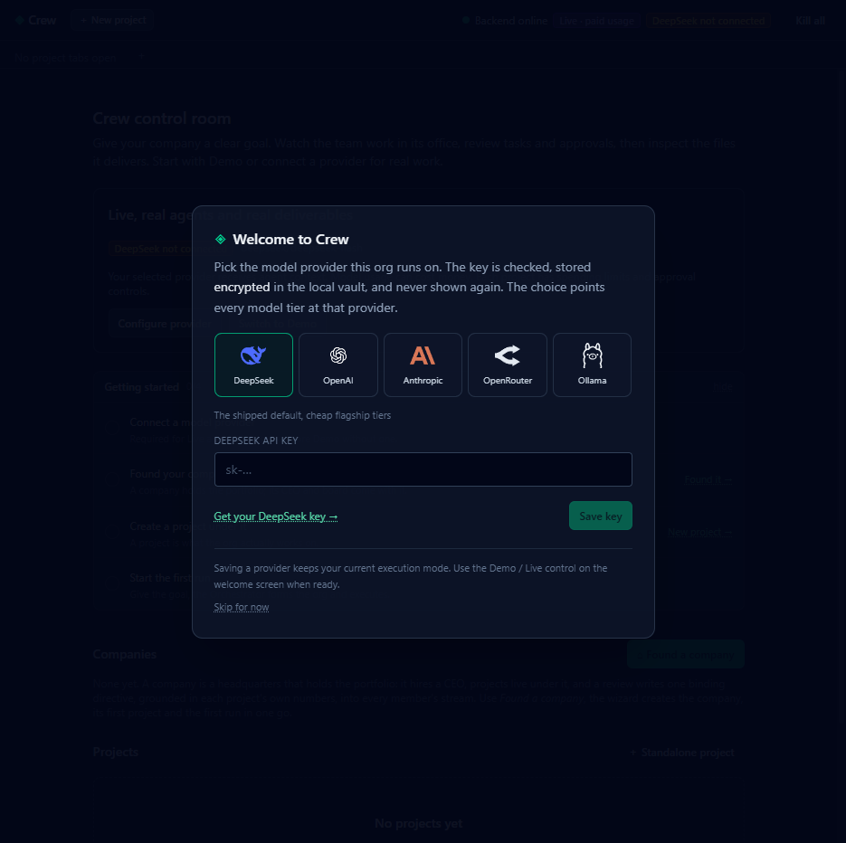

# Crew: a playable control room for real AI agents

Give a company a goal. Watch its agents organize, use tools, produce files, and ask for approvals in an animated office.

[](https://github.com/dogukandemir/crew/actions/workflows/ci.yml)
[](LICENSE)

**Experimental, local-first software.** Crew combines a game-like interface with a real [CrewAI](https://github.com/crewAIInc/crewAI) execution harness. It is for developers and builders exploring supervised agent companies. Agent output still needs human review. It is not a hosted multi-tenant service or a guarantee of autonomous business success.

### At a glance

- **Execution engine:** CrewAI: planning, hiring, tasks and tool calls are real records; the office is a view of the same events.
- **Providers:** DeepSeek (shipped default), OpenAI, Anthropic, OpenRouter, or local Ollama. Demo needs no key and spends nothing.
- **Runtime:** Python 3.13 backend, React 19 / Node 26 frontend, Docker for agent command execution, SQLite for state.
- **Distribution:** one `docker compose up --build`; both ports bind to loopback only.
- **License:** MIT. **Status:** experimental; one trusted workspace per installation.


## Try it

Install Docker Desktop with Linux containers, or Docker Engine 26+ with Compose. From this checkout:

```sh
docker compose up --build
```

Open [the control room](http://localhost:5173). The first build downloads the agent runtime and container images; later starts reuse them. The API listens at `127.0.0.1:8787`. Both published ports are restricted to this computer.

1. Start in **Demo**. It uses deterministic simulated agents, makes no model requests, and incurs no provider usage charges.
2. Choose **Found your company**, select a template, and review the goal and spending caps. The first run starts only if you select its checkbox.
3. Open the project's office, tasks, and deliverables. Demo files are labelled simulated.
4. For real work, choose **Configure provider**, connect a provider, then explicitly **Enable Live**. Saving a key alone does not enable Live.
5. Give the first Live run a small, checkable goal, such as the [first-project recipe](docs/FIRST-PROJECT.md). Review actual files and verification results before using them.

Stop the app with `docker compose stop`. Resume with `docker compose up -d`. Named volumes preserve the database, encrypted vault, and project files. `docker compose down` also keeps volumes; adding `--volumes` deletes them.

## What is real?

| Capability | Demo | Live |
|---|---|---|
| Company, projects, tasks and event history | Real saved records | Real saved records |
| Agent reasoning and planning | Simulated | Your selected model provider |
| Deliverable files | Labelled sample output | Files actually created by agents |
| Shell / Python tools | Not used by the simulated runner | Disposable Docker containers |
| Model spend | Zero | Estimated from token usage and a price table |
| Verification | Simulation checks | Artifact integrity, declared contracts and model review |
| Office movement | Visualization of application state | Visualization of application state |

The office makes work visible; the saved task, tool and artifact records are the source of truth. Rewards are internal scores, not money paid to agents. A successful verifier result does not replace a human quality or security review.

See [a verified DeepSeek example](examples/temperature-converter/PROVENANCE.md): actual source files, ten passing tests and the captured execution report. Its provenance records the repairs, operator approval and cumulative cost needed to complete the workflow.

<p>
  
  
  
</p>

## Providers and installation

<p>
  
</p>

The picker offers DeepSeek, OpenAI, Anthropic, OpenRouter, and local Ollama. The bounded DeepSeek/Docker workflow has passed real-provider acceptance; the other integrations remain experimental. See the [tested support matrix](docs/SUPPORT-MATRIX.md) for exact evidence and limitations. Hosted providers need your own account and credentials. Ollama needs its server and the configured model installed. Docker reaches host Ollama through `host.docker.internal`; native installs normally use `localhost`. Provider availability and model access depend on your account.

Keys are encrypted locally. Model requests send task context to the selected provider. Web tools can access approved public destinations even when the model itself is local. Read [privacy and security](SECURITY.md) before giving agents private work.

For development, use Python 3.13, uv, Node 26, and Docker for command tools. In separate terminals:

```sh
cd backend
uv sync --frozen
uv run python -m crew serve
```

```sh
cd frontend
npm ci
npm run dev
```

Both commands also work in PowerShell. No environment file or provider key is needed for Demo. Optional settings are listed in [.env.example](.env.example). Keep the Vite port at 5173 or explicitly update the backend's allowed browser origins. See [installation and upgrades](docs/INSTALLATION.md) for authentication, storage, troubleshooting and recovery.

## Architecture

React renders the company and project views. FastAPI owns the API and event stream. The orchestrator plans and assigns work, CrewAI runs individual agents, and a shared model gateway reserves and records estimated usage. Capability checks and approvals guard tools. SQLite stores application state, budgets, audit records and events; project folders hold files.

The Docker distribution has three services: a static frontend, the API, and a private sandbox broker. Only the broker receives the Docker daemon socket. Command containers have no network, a read-only root, resource limits, and one project directory mounted for work. See [the security model](SECURITY.md) for its trust boundary.

This release supports **one server process and one shared workspace**. Viewer accounts can read that workspace; operators can run work; administrators manage credentials and execution mode. Do not use it to host mutually untrusted tenants.

## Current limits

- Spending caps use estimates, not a provider invoice. Failed or interrupted requests with unknown usage are charged conservatively. Set provider-side billing limits as well.
- Stopping a run blocks subsequent tool/model calls and requests container termination. A model request already sent may finish and bill. Server restarts pause interrupted runs for review.
- Network allowlists and deterministic content checks reduce exposure; they do not prove a page or command safe.
- One bounded DeepSeek workflow passed Live acceptance. Other providers and clean installations on additional platforms still need release validation. The [implementation tracker](docs/reviews/2026-10-10/IMPLEMENTATION.md) distinguishes changes from verified results.
- CrewAI still brings Chroma transitively. Its outstanding advisory assessment is recorded in [dependency notes](docs/DEPENDENCIES.md); no Chroma server is shipped.

## Contribute

Read [CONTRIBUTING.md](CONTRIBUTING.md) for the development loop and [the code of conduct](CODE_OF_CONDUCT.md). Small, reproducible examples are especially useful: a goal, expected deliverable, observed result, and redacted logs. Use private reporting for security concerns.

The public-readiness [review](docs/reviews/2026-10-10/REPORT.md) and [action plan](docs/reviews/2026-10-10/ACTION-PLAN.md) explain the work underway. Design documents in `docs/` describe both implemented behavior and earlier proposals; the code and current installation guide take precedence.

Crew's application code is [MIT licensed](LICENSE). Dependencies keep their own licenses; see [third-party notices](THIRD_PARTY_NOTICES.md).
