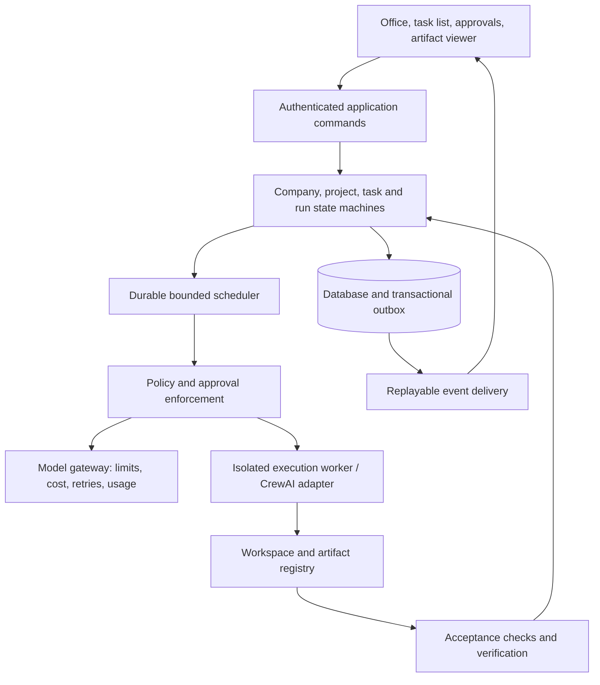
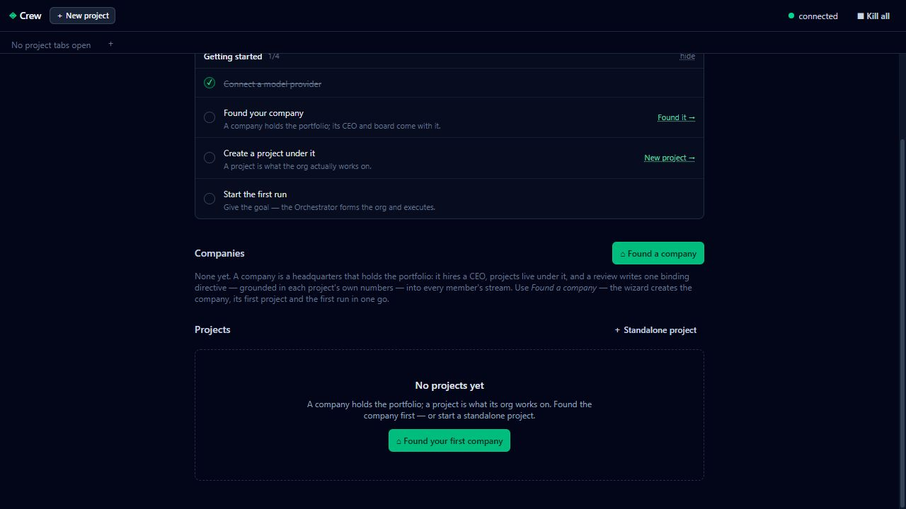
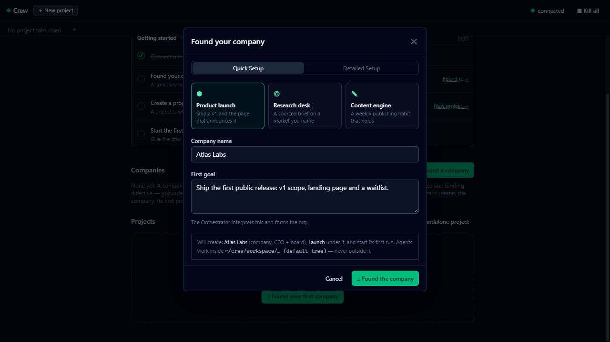
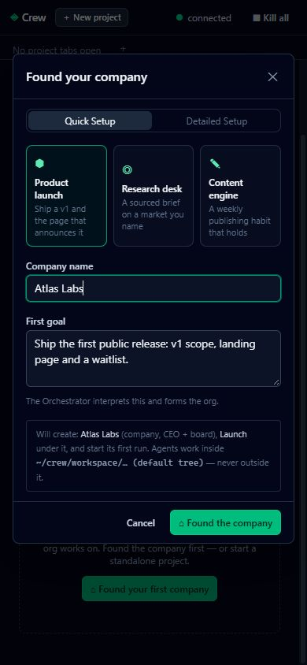

# Crew: public release readiness review

**Reviewed:** 10 October 2026
**Reference commit:** `b447c13a35b57a6757c9bf78242cfd42fddad285`
**Requested deliverable:** review and prioritized action plan; no application fixes
**Product intent:** a game-like company operated by real agents, pursuing real project goals through a real execution harness.

Companion documents: [prioritized action plan](ACTION-PLAN.md) · [verification evidence and limitations](EVIDENCE.md).

**Current status:** This baseline review is preserved. Subsequent fixes and remaining gates are recorded in [IMPLEMENTATION.md](IMPLEMENTATION.md); the bounded real-provider result is recorded in [LIVE-ACCEPTANCE.md](LIVE-ACCEPTANCE.md).

## 1. Executive assessment

Crew has a credible and interesting foundation: a working interface, a real CrewAI integration, organizational state, tool governance, an event stream, a local secret vault, and a substantial automated test suite. It is more than a visual mockup. The company metaphor can make otherwise opaque agent work understandable and enjoyable.

**It is not yet ready for a broadly promoted public release as a dependable autonomous company.** The largest problems concern the meaning of its promises: an agent can escape the intended file boundary through a path-prefix error; real tool execution omits the project object needed to enforce project policies; spending reservations can race; a nonexistent deliverable can pass verification; and stopping a run does not reliably stop its work. The default container configuration also exposes an unauthenticated development API beyond the loopback interface.

These problems are fixable without rewriting the product. The right next step is a bounded, local-first alpha with one convincing end-to-end workflow. Make the company reliably produce a small, inspectable artifact, account for its cost, survive interruption, and explain its decisions. Then use the office as an engaging view of that evidence.

Public code publication and a major product launch are different gates. After the immediate security and disclosure work, an explicitly experimental repository could invite contributors. A wide launch should wait for the live execution, installation, persistence, and outcome-verification gates in the action plan. No engineering or marketing work can guarantee virality; this plan aims to improve trust, activation, repeat use, and shareability.

| Area | Current assessment | Main release constraint |
|---|---|---|
| Product concept | Strong, demonstrable appeal | Must show useful work beyond animated activity |
| Technical implementation | Substantial alpha | Lifecycle, concurrency, and persistence need stronger invariants |
| Agent harness | Real integration, partly validated | No paid live run verified in this review; provider and sandbox gaps |
| Security | Broad design, incomplete enforcement | Workspace escape, missing project policy, unsafe default exposure |
| Financial controls | Useful accounting foundation | Reservations and model-call coverage do not provide a hard cap |
| UI/UX | Distinctive, feature-rich | Demo/live ambiguity, hidden spend settings, crowded information hierarchy |
| Installation | Demo backend builds and starts | Live-provider transition, container execution, workspace durability |
| Open-source readiness | MIT repository with CI and documentation | Contribution/security policies, dependency review, reproducible release |
| Marketing | Memorable visual hook | Positioning overlaps existing projects; claims exceed tested behavior |

## 2. Scope and confidence

The review covered the tracked application, configuration, documentation, dependency lockfiles, tests, Git history secret scanning, an isolated backend container, and the actual first-run UI connected to an isolated offline backend. The reference checkout contained 263 tracked files.

The existing checks passed: **202 backend tests**, **284 frontend tests across 32 files**, backend lint, and the production frontend build. One live backend test was deselected by the repository's normal configuration. Additional synthetic probes reproduced several failures that the existing suite does not catch.

Findings use these evidence labels:

- **Reproduced:** observed with isolated synthetic data or an actual local build/browser session.
- **Code-confirmed:** a reachable implementation path is present, but a full exploit or production-scale failure was not exercised.
- **Unverified:** needs a real provider, deployment environment, user study, or further reachability analysis.

This is a source and local behavior review, not a penetration-test certification. No paid provider calls, external attack attempts, deployment, publication, or application changes were performed. GitHub repository settings and branch protection were not inspected. UI observations are limited to first-run/onboarding; historical screenshots are explicitly distinguished below.

## 3. What is worth preserving

1. **The separation between organization and execution.** Domain state, control logic, execution tools, and the visual interface already have recognizable boundaries. Crew can remain a modular monolith while those boundaries become stricter.
2. **The game presentation.** The office and character system are memorable and can turn long-running work into something understandable at a glance. The visual layer should remain derived from runtime events.
3. **The governance vocabulary.** Capabilities, approvals, budgets, model tiers, security review, and audit records are the right concepts. The main task is making their enforcement complete and consistent.
4. **Offline development and tests.** A keyless deterministic mode is valuable for onboarding, contributors, CI, and demonstrations, provided it is unmistakably labeled as a simulation.
5. **An existing test and documentation culture.** The suite and architecture decision records provide a good base for corrective work. Their coverage must now extend to adversarial boundaries and failure recovery.
6. **Useful execution hardening already exists.** Shell/Python containers use network isolation, a read-only root filesystem, temporary storage, and resource limits. These are meaningful controls even though orchestration and deployment gaps remain.

## 4. Findings requiring action

Priority meanings: **P0** = immediate public-release blocker; **P1** = required before recommending live use or a broad launch; **P2** = important hardening, usability, or growth work. Priority reflects this product's intended use, not a formal CVSS score. Authentication findings become immediate blockers for any shared or remotely accessible deployment.

### F01 — P0: the file jail accepts sibling directories

**Reproduced.** [`execution/tools.py:63–70`](../../../backend/src/crew/execution/tools.py#L63) checks containment with a string prefix after resolving the path. A workspace named `workspace` therefore also accepts a sibling named `workspace-other`. A synthetic read of `../workspace-other/canary.txt` succeeded. Read, write, list, and delete helpers share this check.

**Impact:** an agent can access files outside its assigned project if a sibling path shares the prefix. This contradicts the repository's workspace isolation claim. A delete request resolving to the workspace root also needs an explicit prohibition.

**Required change:** use path-aware ancestry checks; reject the root for destructive operations; test sibling prefixes, traversal, absolute paths, case behavior, and symlinks on supported platforms. A path check alone does not eliminate symlink race conditions: enforce the same filesystem boundary in the execution environment.

### F02 — P0: real tool execution omits project policy context

**Code-confirmed.** [`execution/runner.py:117`](../../../backend/src/crew/execution/runner.py#L117) constructs `ToolContext` without its project object. [`execution/tools.py:717`](../../../backend/src/crew/execution/tools.py#L717) consequently passes `None` into policy evaluation. Project-specific pause state, deny settings, approval requirements, and extra egress configuration are not evaluated through that object. Agent role and grant checks still exist; this is not a complete absence of security.

**Impact:** settings shown to the operator can fail to govern the actual worker. Fixing only the UI or policy unit tests will not close this gap.

**Required change:** make project/run identity mandatory and reload authoritative policy at each tool boundary. Fail closed if the project cannot be resolved. Add an integration test that changes policy while a real runner task is active and proves the next tool call is denied.

### F03 — P0: default Docker networking exposes an unauthenticated API

**Configuration reproduced; exposure inferred from Docker semantics.** [`docker-compose.yml:15`](../../../docker-compose.yml#L15) publishes `8787:8787`, while the backend listens on `0.0.0.0` and defaults to development/local authentication. [`core/settings.py:105`](../../../backend/src/crew/core/settings.py#L105) only rejects unsafe local authentication outside development mode. A development configuration with a non-loopback host was accepted in a probe.

Omitting the host IP publishes a Docker port on all host interfaces by default; actual external reachability still depends on firewall and network configuration. See [Docker port publishing](https://docs.docker.com/engine/network/port-publishing/). CORS does not authenticate requests. The WebSocket handler also lacks an Origin check.

**Required change:** bind the local-first distribution to `127.0.0.1` on the host; explicitly reject unsafe deployment combinations; validate browser Origin/Host where appropriate; use an authenticated local bootstrap mechanism. Make remote hosting a separately documented, tested configuration.

### F04 — P1, P0 for remote use: token authentication does not establish meaningful authorization

**Reproduced and code-confirmed.** The entire API router requires authentication at [`api/routes.py:68`](../../../backend/src/crew/api/routes.py#L68), including its login route around line 515. An unauthenticated login request in token mode returned 401. A validly signed viewer token with a nonexistent user ID could update a project and received 200.

[`api/auth.py`](../../../backend/src/crew/api/auth.py) supplies a predictable fallback signing secret, accepts signed claims without resolving a current active user, and defines an administrator dependency that the routes do not apply. Production token settings accepted an empty configured signing secret. The frontend's `VITE_AUTH_TOKEN` mechanism embeds a token in browser-delivered configuration and is unsuitable as a private deployment secret.

**Required change:** separate unauthenticated login/bootstrap routes; require a strong configured secret for token mode; resolve current users and disabled/revoked state; enforce an explicit role and ownership matrix on each operation. A viewer must not change budgets, approve tools, write secrets, or stop projects. Avoid shipping shared credentials in the frontend bundle.

### F05 — P1: spending caps are neither atomic nor comprehensive

**Reproduced.** [`core/security.py:300`](../../../backend/src/crew/core/security.py#L300) separates reservation reads, counters, and ledger writes. With a controlled concurrent interleaving, two reservations of 80 each both succeeded against 100 available: the ledger totaled 160 while the stored reservation counter was 80. Reusing an idempotency key caused an integrity error after the counter had already changed: counter 20, ledger 10.

**Code-confirmed scope gaps:** [`control/orchestrator.py:449`](../../../backend/src/crew/control/orchestrator.py#L449) reserves an estimate before a worker can perform multiple model iterations. Planner, judge, and council model calls use separate paths. Agent reservations do not consistently include department/company limits. Fields described as daily spend do not have a demonstrated daily rollover path. Failed provider work can be represented as zero cost when usage is unknown.

**Impact:** “budgets with teeth” and hard-stop claims are stronger than the implementation. A cap must cover all model calls, concurrency, retries, and uncertain billing outcomes.

**Required change:** a central model gateway with atomic, idempotent reservations for every billable call; hierarchical limits; explicit time windows; settlement and reconciliation on success, failure, timeout, and restart. Set output/token limits before requests. Label estimated versus provider-reported usage and expose unknown cost instead of silently converting it to zero.

### F06 — P1: verification can reward imaginary deliverables

**Reproduced.** [`control/verify.py:51`](../../../backend/src/crew/control/verify.py#L51) accepts keyword overlap and filename/URL-shaped text as evidence. A narrative referring to nonexistent `imaginary.py`, with no artifacts and a mocked judge explicitly rejecting the result, still returned **pass, quality 1.0**. The final quality selection around line 135 allows the heuristic score to override a negative judge.

**Impact:** a successful-looking company can produce no usable work. Rewards, promotions, and model-tier decisions then reinforce false success. This is the most important product-trust problem after containment.

**Required change:** task-specific acceptance contracts backed by actual artifacts, hashes, executable checks, or structured evidence. A claimed file must exist in the correct workspace. Failed mandatory checks must veto success. Distinguish verified, partially verified, failed, and unable-to-verify outcomes. Keep simulated results visibly separate from real results.

### F07 — P1: stop, pause, cancel, and recovery are not reliable control contracts

**Code-confirmed.** [`control/orchestrator.py:1034`](../../../backend/src/crew/control/orchestrator.py#L1034) changes run state and opens an in-memory breaker, but does not reliably terminate an in-flight worker. API cancellation around [`api/routes.py:900`](../../../backend/src/crew/api/routes.py#L900) updates stored status; execution does not consistently treat that terminal status as a prohibition on subsequent work or completion. Project pause and run pause are not the same checked state. Resume does not fully restore paused-budget execution.

The Docker subprocess timeout path lacks guaranteed named-container cleanup. Killing a Docker client is not a reliable promise that its container workload has stopped. Restart recovery marks some running tasks failed but does not fully reconcile reservations, artifacts, or side effects.

**Required change:** define separate semantics for “stop scheduling,” “pause at next boundary,” and “terminate active execution.” Implement cancellation tokens and worker/container termination, guard terminal state transitions, and reconcile outstanding reservations during recovery. The UI must state the achieved action accurately; do not promise that all in-flight work has been aborted unless it has.

### F08 — P1: allowed HTTP requests can redirect outside the intended egress boundary

**Code-confirmed.** [`execution/tools.py:93`](../../../backend/src/crew/execution/tools.py#L93) follows redirects while the HTTP tool validates the initial host. Private-host matching is based on host text, not the full set of resolved addresses at connection time. A permitted site can redirect to an internal or otherwise disallowed destination before content review occurs.

**Required change:** validate scheme, port, resolved addresses, and every redirect hop; block loopback, link-local, private, and metadata destinations unless explicitly intended. Protect against DNS changes between validation and connection. Prefer one enforced egress service for all agent networking. Stream responses with a byte/time limit rather than downloading an unbounded body and truncating afterward.

### F09 — P1: approvals can outlive their intended authority

**Reproduced.** An approval whose expiry was yesterday still authorized `fs.delete` through [`core/security.py:476`](../../../backend/src/crew/core/security.py#L476). General grants are broader than a specific tool invocation and do not establish a one-use, argument-bound approval contract. Security-review approvals also need expiry/revocation consistency.

Command normalization collapses whitespace, including whitespace inside quoted content or code. That is an unsafe basis for deciding whether two commands have the same approved meaning.

**Required change:** define reusable versus one-shot grants explicitly. Bind one-shot approval to project, run, agent, capability, canonical typed arguments, expiry, and consumption state. Preserve the exact command bytes for command approval hashes. Show what is being approved, the scope, and the duration.

### F10 — P1: secret protection has gaps across loading, logging, and storage

**Code-confirmed.** The exact-string redactor learns secrets during creation/import, but provider keys loaded from the vault at startup are not consistently registered. Tool arguments and runner callbacks can reach persisted events before centralized redaction; sanitizing the final result is insufficient. Relevant paths include [`core/security.py:171`](../../../backend/src/crew/core/security.py#L171), [`control/onboarding.py:230`](../../../backend/src/crew/control/onboarding.py#L230), and [`execution/tools.py:743`](../../../backend/src/crew/execution/tools.py#L743).

The vault key is stored alongside the database unless externally configured. Encryption remains useful, but copying the complete data directory can copy the key too; file permissions and backup handling matter. Dependency telemetry behavior also needs explicit configuration and disclosure before making privacy claims. The installed CrewAI core recognizes telemetry-disable environment flags; Crew does not make this an explicit deployment policy.

**Required change:** redact centrally at persistence, logging, event, and export boundaries; register secrets on every load; use restrictive file permissions; document key rotation and recovery; test redaction after restart. Replace absolute “nothing leaves your machine” language with a precise description of provider requests, enabled tools, and telemetry settings.

### F11 — P1: workspace identity and container persistence can lose or mix real work

**Reproduced:** two distinct projects with the same display name in one company received the same workspace path through [`control/workspaces.py`](../../../backend/src/crew/control/workspaces.py).

**Code-confirmed:** the default workspace location inside the backend container is outside `/data`, the only persisted backend volume. Container recreation can therefore discard generated files while database records survive. A host path entered into the UI is interpreted inside the container unless deliberately mounted.

**Required change:** use immutable IDs in workspace allocation, store a durable mapping, persist workspaces separately, and define a safe host-folder mounting workflow. Test project rename, duplicate names, backup/restore, and container recreation with real artifact files.

### F12 — P1: the documented live setup does not match the distribution

The backend image **did build and start with its default command**. There is no general Docker boot failure. However:

- Root `.env` provider keys are not passed into the container by the current Compose file; only selected settings are mapped. Adding a key also does not disable the default offline mode.
- Saving a provider in onboarding does not establish a reliable transition from an already initialized offline runner to live execution.
- The image has no Docker executable or execution service, while shell/Python tools require a Docker sandbox. The default container cannot perform the advertised sandboxed code work without additional infrastructure.
- **Reproduced:** the Anthropic preset fails at constructor time because the Anthropic provider extra is absent. OpenAI, DeepSeek, OpenRouter, and Ollama constructors succeeded without network calls; missing LiteLLM is not itself a defect for those routes.
- Ollama's default localhost means the backend container itself, not the host. The onboarding request requires a minimum-length key even though the UI describes Ollama as keyless; readiness also needs to verify that the selected model is installed.

**Required change:** make Demo and Live explicit runtime modes; ship a supported sandbox worker; validate each advertised provider; provide host/container-specific Ollama instructions. Do not solve the sandbox gap by casually granting the entire API container unrestricted control of the host Docker daemon. See [CrewAI's provider migration guidance](https://github.com/crewAIInc/crewAI/blob/main/docs/v1.15.17/en/learn/litellm-removal-guide.mdx).

### F13 — P1: durable deployment lacks a versioned database upgrade path

**Code-confirmed.** [`core/db.py:73`](../../../backend/src/crew/core/db.py#L73) creates tables in development but skips creation in production. The repository does not include the migration system described by the architecture documentation; existing additive schema handling is not a complete migration history.

**Required change:** provide versioned migrations, a fresh-install production path, upgrade fixtures from prior releases, and backup/restore instructions. A successful developer database startup does not establish safe upgrades for public users.

### F14 — P1: event delivery can silently omit history

**Code-confirmed.** [`api/ws.py:108`](../../../backend/src/crew/api/ws.py#L108) replays at most 2,000 events before signaling replay completion with the stream head. A longer disconnection can skip the remainder. Queue overflow and frame truncation can drop events without a consistent gap notification. The frontend has gap-handling concepts that the server does not fully implement.

[`core/events.py`](../../../backend/src/crew/core/events.py) allocates sequence numbers separately from persistence, and validates some events after publication/persistence. Domain changes and their events are separate commits. The current design is a database-backed application with an event log, not complete event sourcing. Concurrent audit appends also need serialization to preserve a single hash chain.

**Required change:** commit domain changes and an outbox record together; paginate replay; make sequence gaps explicit; deduplicate delivery; reconcile from snapshots. Test overflow, reconnect beyond 2,000 events, and concurrent writers. Keep the audit-chain threat model honest: local hash chaining alone is not an externally anchored tamper-proof record.

### F15 — P1: concurrency and blocking work can overwhelm the control plane

**Code-confirmed.** The execution semaphore around [`control/orchestrator.py:242`](../../../backend/src/crew/control/orchestrator.py#L242) is created per run, not globally. Multiple runs can each consume the full allowance. Synchronous model calls in asynchronous planning/judging/council code can block the API event loop. In-memory background task tracking is not durable scheduling.

**Required change:** enforce a shared scheduler with company/project/provider limits; isolate blocking calls; apply timeouts; store job ownership and leases. Begin with a single supported application process and a bounded worker pool. Multiple services or a new database are not prerequisites for solving this.

### F16 — P1/P2: dependency risk and licensing need an explicit release decision

**Reproduced scan:** the installed Python environment reports five vulnerability records for `chromadb==1.1.1`, representing **four unique advisories**. They include upstream code-execution and authorization issues. The scanner did not identify a fixed version. Crew's own memory implementation uses SQL/lexical search, and no Chroma server configuration was found; **this review did not establish that Crew exposes those vulnerable server paths**. Do not describe this as a demonstrated remote-code-execution exploit in Crew.

**Required change:** trace why Chroma is installed, remove unused dependency surfaces where possible, document reachability, and apply a verified upstream fix or mitigation when available. Do not blindly recommend an upgrade as if a patched version had been confirmed. Details and primary advisory links are in [the evidence record](EVIDENCE.md#dependency-audit).

`crewai-tools` also brings a substantial dependency tree, including PyMuPDF. No application import of `crewai_tools` was found. PyMuPDF is offered under AGPL or commercial terms; review distribution/use obligations and remove the dependency if unnecessary. This is a licensing review item, not a conclusion that the repository's MIT license is invalid. See [the vendor's licensing page](https://pymupdf.io/licensing).

The npm audit returned zero known vulnerabilities. Git-history secret scanning produced six historical test-fixture matches, not confirmed real credentials. Add continuous scanning rather than treating either result as a permanent guarantee.

### F17 — P1: the first-run flow blurs simulation, readiness, and spending

**Observed in the actual offline UI.** The first-run screen shows a connected state and completed provider step without a prominent Demo/offline label. A user can reasonably infer that a real model is ready. The founding wizard's quick flow hides budgets under detailed setup, while submission creates the company/project and starts a run.

**Required change:** always show Demo or Live next to connection status. Before starting, show provider/model, workspace, spending cap, network/tool permissions, and the expected deliverable. Make “Create company” and “Start first project” distinct choices or clearly disclose the combined action. When live execution is unavailable, give a specific corrective action rather than a generic green readiness state.

### F18 — P2: accessibility and navigation need consolidation

**Observed:** the founding modal fits a 390-pixel viewport without global horizontal overflow, but its dense columns and small helper text reduce readability. Keyboard navigation can leave the open modal; this was verified without submitting the form. The dialog lacks a complete accessible-name/focus-management contract.

Implement labeling, initial focus, focus containment/restoration, and inert background content following the [W3C modal dialog pattern](https://www.w3.org/WAI/ARIA/apg/patterns/dialog-modal/). Add reduced-motion behavior, visible focus states, and non-color status indicators. The canvas should have an accessible list/table counterpart.

The production build succeeds but warns about the main JavaScript chunk at approximately 552 kB before compression. Lazy-load heavy views and measure real interaction performance before expanding the visual simulation. No frame-rate or Core Web Vitals benchmark was performed; the bundle warning is not proof of an unusably slow application.

### F19 — P1/P2: API contracts and multi-step commands need stronger boundaries

**Code-confirmed.** Large route modules use loosely structured request/response data and repeated state-changing logic. Founding spans multiple committed operations and then starts work. A retry after a partial failure can create duplicates or leave a partial company. Several state strings and text/dictionary inputs need tighter validation and bounds.

**Required change:** model state transitions explicitly; validate state enums and payload limits; give long-running commands an idempotency key and durable result; generate frontend types from a versioned API schema. Keep business rules in application services rather than route handlers. The approximately 1,980-line routes module, 1,262-line organization module, and 1,081-line orchestrator are useful refactoring boundaries, not evidence that a full rewrite is necessary.

### F20 — P2: public repository packaging and claims need editorial repair

The repository needs a security reporting policy, contribution guide, code of conduct, issue/PR templates, release notes, maintainer expectations, and a repeatable release workflow. The current CI validates application tests/builds but does not establish clean cross-platform installation, supported-provider behavior, dependency review, or secret scanning.

There is no `.dockerignore`; frontend `COPY . .` can include local dependencies or environment files from a developer checkout. The frontend container runs a development server. The backend default command rebuilds its editable package at startup, which worked in this review but should move to a deterministic image build for releases.

Documentation also overstates or drifts from implementation: jailed file access, hard spending stops, video-like replay, complete cost visibility, and a subprocess fallback need correction. Asset provenance should be explicit: references to an in-house generator are useful, but the generator or a clear creation/license record should accompany distributed artwork.

## 5. Recommended architecture

Keep the modular monolith and make the execution boundary explicit. The product's distinctive value belongs in company/project governance, durable coordination, and the visual explanation of real work. Treat CrewAI as an execution adapter rather than allowing model calls to spread throughout control modules.

The essential contracts are:

- **Execution adapter:** start, inspect, cancel, and recover a task; typed tool/model events; explicit artifact and usage outputs.
- **Policy service:** evaluate current actor/project/run policy at the point of action, with a recorded decision.
- **Model gateway:** cover worker, planner, judge, and council calls with the same spending and timeout rules.
- **Artifact registry:** identify actual workspace outputs by immutable ID, relative path, hash, producing task, and verification result.
- **State machine:** prohibit transitions out of terminal states without an explicit retry command; make recovery decisions explainable.
- **Event contract:** version payloads and sequence rules; treat animations as consumers of state, never proof that work occurred.

SQLite can remain appropriate for a single-user/local-first release. Document that operating envelope and serialize sensitive writes. Move to another database or a distributed queue only when measured concurrency or hosting requirements justify it. First untangle cross-layer imports and duplicate model-call paths.

## 6. Product and UI/UX direction

### Make the company legible through outcomes

The first screen should answer four questions: **What is the company trying to deliver? What is happening now? What needs me? What has it actually produced?** The office can answer the second question visually, but should not obscure the other three.

Recommended primary navigation: **Company → Project → Work / Office / Results**, with approvals and spending always visible. Reduce competing create actions on first launch. Use plain language in the default view; expose detailed event names, model routing, and policy internals in an inspector.

Each agent should have an inspectable connection to its current task, actual last tool/model activity, elapsed time, cost state, and output. Label idle/decorative movement as such if needed. Display **simulated**, **observed**, and **inferred** activity distinctly. Replaying an event stream must not imply replaying the underlying execution.

Rewards should reflect verified delivery, cost efficiency, and responsible escalation. Avoid incentivizing maximum activity, agent proliferation, or spending merely to keep the office lively. A quiet company that finished correctly is a success.

### A better first successful journey

1. Choose **Try demo** or **Connect a real provider**.
2. Select one bounded task with a clear output, such as generating a local landing page with a passing build, or fixing a small issue in a disposable example repository.
3. See the delivery criteria, workspace, spending ceiling, and permissions before starting.
4. Watch the team form; see a short explanation of why each role exists.
5. Inspect one real tool action and any approval needed.
6. Open the finished artifact, test evidence, and actual/estimated cost summary.
7. Export a redacted result card or replay with an explicit Demo/Live badge.

Suggested activation targets are under three minutes for the demo and under fifteen minutes for a supported first live task. These are product targets, not measured performance claims. Start with one dependable template; broad “launch a company” templates currently imply capabilities, such as external publishing, that are not yet demonstrated.

### Observed first-run screens

These captures were taken during this review against the real local interface and an isolated offline backend. They document onboarding, not a paid live run.

The welcome screen has useful guidance but should make simulation mode unmistakable and converge on one primary next action.

The quick setup is approachable, but spending and permission decisions need to appear before the action that starts work.

The mobile dialog fits the viewport. Improve text density and touch/focus behavior before advertising a fully supported mobile experience.

Existing repository office/HQ screenshots show appealing art alongside tiny labels, competing controls, and unused space. They are historical assets, so this review does not treat them as proof of current rendering regressions. Refresh marketing captures after the flagship workflow is stable.

## 7. Positioning and marketing

### Recommended initial audience and promise

Start with technically curious indie builders and agent developers who want to supervise bounded software/content projects locally. “A company that does anything” attracts attention but creates expectations the current execution surface cannot satisfy.

Suggested positioning after the corresponding release gates pass:

> Run an AI company from a pixel office. Give it a project, watch the team work, approve important actions, and inspect the files it delivers.

Supporting copy should explain that the office reflects real agent execution, name the supported harness, and distinguish the keyless simulation from live work. Avoid promises of guaranteed profit, unrestricted autonomy, complete safety, or instant production readiness.

### Competitive context

| Reference | What already exists | Implication for Crew |
|---|---|---|
| [Pixel Agents](https://github.com/pixel-agents-hq/pixel-agents) | Animated office visualization of coding agents | Pixel-office presentation alone is not a defensible differentiator |
| [ChatDev](https://github.com/OpenBMB/ChatDev) | Multi-agent organization/workflow concepts, including a virtual company lineage | Company roles and delegation need a specific practical advantage |
| [CrewAI](https://crewai.com/open-source) | The underlying agent/orchestration ecosystem | Clearly distinguish the Crew product from its harness and explain integration value |

This is directional positioning research, not a complete feature benchmark. The strongest potential distinction is **persistent company/project governance with inspectable, verified deliverables, presented through a game-like interface**. Demonstrate that loop before claiming superiority.

The name “Crew” is short but overlaps heavily with CrewAI terminology and common language. Search/discovery confusion is a plausible risk; this review did not perform trademark clearance. At minimum, use a distinctive descriptor and consistent visual identity. Decide whether to rename before investing in launch assets and package names.

### Build a proof-led launch

The flagship demonstration should show the user's goal, the formed team, one real approval/tool action, the resulting files or application, passing acceptance checks, and the cost. A concise 45–90 second recording is a reasonable format. Clearly label accelerated footage and simulations. Publish the example project so viewers can reproduce the outcome.

The README should present, in order: one-line promise, short demonstration, Demo versus Live explanation, supported installation, first successful task, supported capabilities/limitations, architecture, security model, contribution path, and license notices. Put an honest maturity label near the top. Use fresh screenshots and a visible provider/platform support matrix.

Create a shareable result card containing goal, outcome, selected evidence, duration, and approximate/actual cost. Default to redacting prompts, local paths, credentials, and proprietary file content; preview before export. This gives users a reason to share successful work, rather than relying only on novelty footage.

Launch in stages: invite a small set of users to complete the same bounded task; fix the most common failures; publish the reproducible demo; then share with relevant agent/developer communities and launch channels according to their rules. Respond to real issues and publish transparent release notes. Do not manufacture stars, engagement, or success stories.

Track **installation completion, demo completion, first verified live artifact, time to first value, cost per successful task, recovery success, repeat projects, and voluntary shares**. Stars and video views are secondary signals. Collect diagnostics only with clear consent and a documented privacy policy; local-first users should be able to inspect what would be sent.

## 8. Decision and next step

Do not add more departments, personalities, or animation systems before the core work loop is trustworthy. The highest-value milestone is a clean install that completes one real project, stays within its declared operating limits, produces verifiable artifacts, survives interruption, and gives the user accurate control.

The [action plan](ACTION-PLAN.md) translates the findings into work packages with acceptance criteria and release gates. The [evidence record](EVIDENCE.md) documents what passed, what was reproduced, and what remains untested. Only review documents and screenshots were added in this pass; the application remains unchanged.
